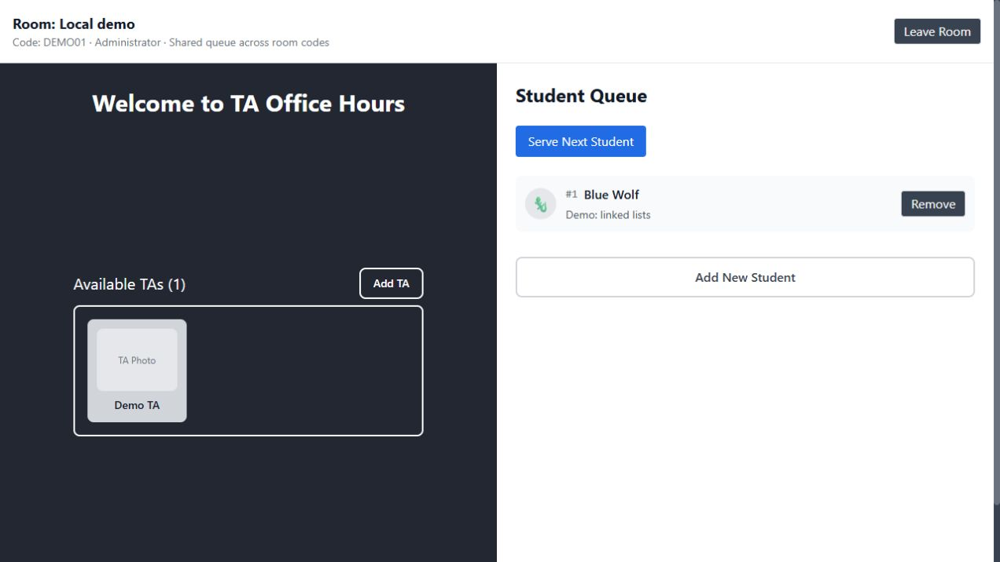

# Local guest/admin walkthrough

Requires Node.js 22 and pnpm 10.17.1. From the repository root:

```sh
pnpm install --frozen-lockfile --ignore-scripts
pnpm demo
```

Open http://127.0.0.1:3000/ after the backend readiness message. The command compiles the backend and starts both workspaces. Ports 3000 and 3001 must be free. Ctrl+C stops the demo; all queue state is discarded. No `.env` file, real credentials, provider account, or external service is required.

The demo backend binds only to 127.0.0.1, seeds room `DEMO01`, creates a fresh random signing secret on startup, and uses a fake notification function. It does not load dotenv or initialize Twilio, even if provider environment variables exist. The printed credentials below are intentionally public, local-demo credentials; the normal backend still requires its own configured authentication.

## Walkthrough

1. In the first browser tab, enter `DEMO01` and choose **Guest**. The header shows Guest view. Administrative controls are absent; available TAs can be viewed.
2. Choose **Add New Student**, enter synthetic number `+15555550121`, and topic `Demo: linked lists`. Optionally select **Notify me when I'm up**; the demo only simulates delivery. Choose **Add Student**. An anonymous display name appears; the number is absent from queue responses.
3. In a second tab, enter username `demo-admin`, password `demo-only-password`, and room code `DEMO01`, then choose **Sign in**. Supplying the room code enters that existing room. Leaving the code blank retains the room-creation prompt.
4. Choose **Add TA**, enter `Demo TA`, then choose **Add TA** in the dialog. Both views show the updated TA list through the existing two-second polling loop.
5. Choose **Serve Next Student** in the admin view. The guest queue becomes empty after polling. With notification consent enabled, the backend prints `demo_notification` with an incremented count, without recipient/message details. This is a simulated notification, not a sent message.
6. A student can rejoin after being served; submitting the same active number twice returns a conflict. Admins can also remove an entry with its explicit **Remove** button or remove a TA by selecting that TA's card.
7. Leave the admin room and enter as Guest. The client clears its stored token/header and management controls disappear. The API independently enforces authorization.



This earlier local walkthrough capture uses synthetic information and predates the room-specific header. The current header reads Room queue. Anonymous names vary on each run.

## Verified boundaries

The active interface polls `/api/rooms/:code/queue` and `/api/rooms/:code/tas`. Each room owns its queue, TA list, position counter and pending duplicate reservations. Room metadata exposes a public projection of its current queue. Unknown/missing codes do not fall back to global state. The configured administrator still manages all rooms; room codes are public entry identifiers rather than private membership credentials. Storage remains in memory and does not survive restart.

To inspect a second room, leave the admin view, sign in with the room code blank and name the new room when prompted. Its queue and TA list start empty. Enter `DEMO01` again to see that room's own state. A pending response from an earlier room visit is ignored by the interface; already submitted mutations still apply to their original room.

Automated checks start the actual demo backend on a random loopback port, inspect its seeded room, join as a guest, reject anonymous serving, sign in, serve with a simulated notification, and confirm the queue is empty. Additional real HTTP checks exercise two rooms, room-local concurrent duplicates, wrong-room IDs, scoped clear/serve, public metadata and removed global routes. These checks run with deliberately irrelevant provider environment values and never invoke a real provider. The frontend production build is also checked in CI; the browser walkthrough above was checked locally.

This is local functionality evidence, without public hosting, real messages, load measurements, durable state, or separate administrator permissions per room. Use synthetic information when reproducing it.


## Keyboard controls

Login has persistent Username, Password and Room code labels. Enter in the sign-in form submits credentials; Guest remains a separate button. Add TA and Add New Student open named native dialogs, move focus to the first field and keep background controls inactive. Escape, Cancel and the named close button dismiss a dialog; focus returns to its opener. Successful submission also restores opener focus. The browser preview uses the same dialogs with its existing read-only synthetic fields. Current browsers with native HTML dialog support are required.
